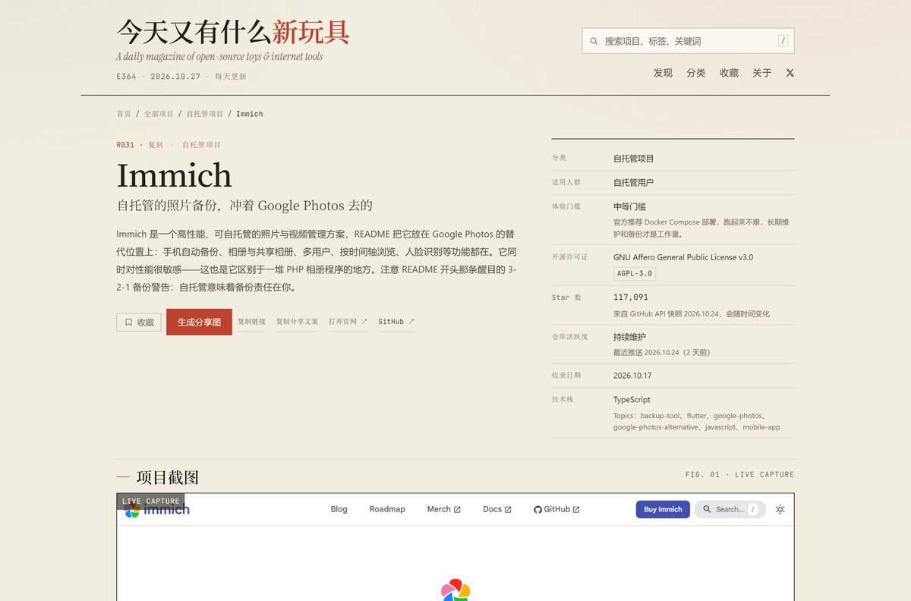
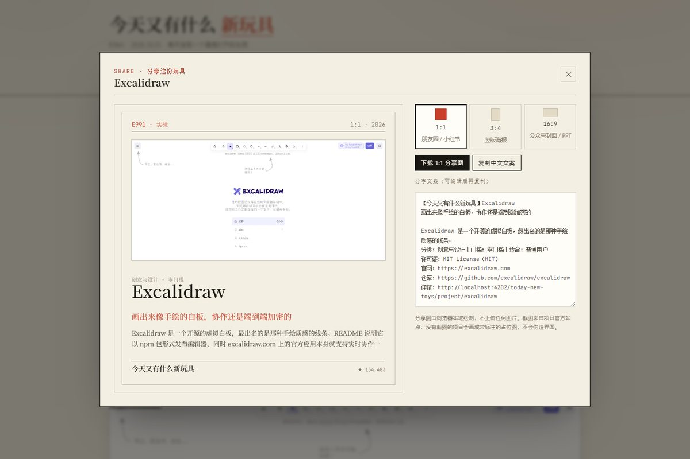

<div align="center">

# 今天又有什么新玩具

**每天发现一个新的开源项目或互联网玩具。**
中文介绍 · 真实截图 · 可核实的数据 · 未知就写未知

[](https://iiiiiiiiiiiiikk.github.io/today-new-toys/)
[](LICENSE)
[](https://iiiiiiiiiiiiikk.github.io/today-new-toys/discover)
[](https://iiiiiiiiiiiiikk.github.io/today-new-toys/categories)

[在线浏览](https://iiiiiiiiiiiiikk.github.io/today-new-toys/) ·
[全部项目](https://iiiiiiiiiiiiikk.github.io/today-new-toys/discover) ·
[分类索引](https://iiiiiiiiiiiiikk.github.io/today-new-toys/categories) ·
[关于这份清单](https://iiiiiiiiiiiiikk.github.io/today-new-toys/about) ·
[作者 𝕏 @0xkillcoin](https://x.com/0xkillcoin)

</div>


---

## 这是什么

一个**中文的开源项目与互联网工具发现站**。它不是排行榜，也不是自动抓取的导航目录，而是一份有人读过 README、打开过官网、然后写下来的清单。

- 📖 **中文介绍**：每个项目的概览、主要功能、适用人群、使用方式都是人工撰写的，详情页会标出依据的是 README 的哪一部分、读了多少字。
- 🖼 **真实截图**：30 个项目的封面全部来自各自官网 / 演示站的实时抓取（带抓取日期），没有一张是设计稿或伪造界面。
- 🧾 **数据诚实**：Star、许可证、最近推送来自 GitHub API 快照；取不到就写「未知」并说明原因，**绝不填 0、不估算、不美化**。
- 🎨 **杂志式排版**：暖纸张底色、朱红点缀、衬线中文标题与等宽数字；桌面三栏、手机单栏，不是后台管理界面。
- ⚡ **纯静态**：没有后端、没有数据库、没有运行时密钥，可以部署到任何静态托管平台。

<table>
<tr>
<td width="50%"></td>
<td width="50%"></td>
</tr>
<tr>
<td align="center"><sub>发现页 · 搜索 / 多标签 AND 筛选 / 排序 / 分页</sub></td>
<td align="center"><sub>详情页 · 数据、依据、截图、同类推荐</sub></td>
</tr>
</table>

<div align="center">

<br><sub>iPhone 390pt 单栏布局（实际渲染截图）</sub>
</div>

---

## 收录了什么

30 个真实项目，10 个分类各 3 个：

| 分类 | 项目 |
| --- | --- |
| **AI 工具** | Ollama · Open WebUI · LobeHub（LobeChat） |
| **开发者工具** | Biome · uv · Hoppscotch |
| **效率工具** | MarkItDown · LocalSend · Espanso |
| **数据可视化** | Evidence · PyGWalker · Observable Plot |
| **创意与设计** | Excalidraw · Penpot · Screenshot to Code |
| **学习工具** | CS 自学指南 · Learn Git Branching · TypeScript Exercises |
| **开源硬件** | QMK Firmware · ESPHome · Flipper Zero |
| **互联网玩具** | Sherlock · IT-Tools · DiceBear |
| **自托管项目** | Immich · Karakeep · Linkwarden |
| **加密与 Web3** | Foundry · Rainbow · MetaMask |

每个项目都有独立页面、可分享 URL、中文分享文案和三种比例的分享图。

---

## 功能

### 发现

- **首页**：今日推荐（按日期确定性轮换）、最新收录、本周热门、编辑精选、分类入口、搜索框、随机发现。
- **搜索**：覆盖项目名、一句话介绍、摘要、功能描述、别名与标签——搜「端到端加密」能找到 Excalidraw，而不只是搜标题。
- **筛选**：分类多选、多标签 **AND**、适用人群、许可证已确认；四种排序；全部分页写入 URL，可直接分享筛选结果。
- **随机发现**：从全部项目里随机跳一个，专治选择困难。

### 详情页

项目概览 · 主要功能 · 适合谁使用 · 使用方式（分步） · 技术栈与许可证 · 真实截图 · 官网 / 仓库 / 演示链接 · 同类推荐 · 收藏 / 复制链接 / 生成分享图 / **提交人工修订**。

同时展示四类「可信度」信息：

| 字段 | 展示方式 |
| --- | --- |
| **内容依据** | README 路径、字数、抓取日期，以及可展开的 README 原始小标题 |
| **许可证** | SPDX 标识 + 名称；自定义许可证附限制说明与原文链接；未声明则显示「未知」 |
| **Star / 活跃度** | 数字 + 快照时间；缺失显示「未知」并说明未做估算 |
| **截图** | 抓取来源 URL + 抓取日期；`LIVE CAPTURE` 或 `REPO PREVIEW` 标识 |

### 收藏与分享

- 收藏保存在 `localStorage`，刷新、关闭浏览器后仍在；同浏览器多标签实时同步。
- 收藏页可导出 **JSON**（含 slug、链接、许可证、收藏时间）与 **Markdown**，也可一键复制为 Markdown。
- 中文分享文案包含名称、一句话、分类、门槛、许可证、官网 / 仓库 / 详情链接，可编辑后再复制。
- 分享图由浏览器 Canvas 本地绘制，支持 **1:1 / 3:4 / 16:9**（1080×1080、1080×1440、1600×900），直接下载 PNG；不上传任何图片。



---

## 数据是怎么来的

```
GitHub REST API ──┐
README 原文 ──────┼──▶ data/repo/<slug>.json ──┐
官网截图 ─────────┘                            ├──▶ public/data/projects.json ──▶ 静态站点
人工撰写的中文介绍 ──▶ data/projects/<slug>.json ┘
```

**两层数据刻意分开**：`data/repo/` 是机器抓来的事实（Star、许可证、最近推送、README 摘要），只由脚本写入；`data/projects/` 是人写的中文文案，只由人编辑。`npm run data:update` 只刷新前者，永远不会覆盖后者。

### 数据可信度约定（写进了代码与测试）

1. **未知就是未知** —— `null` → UI 显示「未知」+ 原因，不填 0。
2. **许可证双重核对** —— GitHub 报 `NOASSERTION` / `Other` 一律当未知；4 个自定义许可证（Open WebUI、LobeHub、ESPHome、MetaMask）人工读 LICENSE 原文后写明限制。
3. **介绍必须有依据** —— 每个项目有 `contentBasis`；README 未读取的项目必须在文案里说明。
4. **截图必须真实** —— 全部来自官网 / 仓库页面，附抓取日期；抓不到用带文字的占位图，不拿相似产品冒充。
5. **「本周热门」不假装是流量榜** —— 站内无埋点，排名 = Star 规模（对数）+ 最近推送时间，算法在 `scripts/build-data.mjs` 里公开。
6. **不重复收录** —— slug、GitHub 全名、项目名三重去重，导入时与构建时各查一次。
7. **自动化不冒充人工** —— `review.status = draft` 的记录永远不会进入构建产物。

---

## 快速开始

```bash
git clone https://github.com/iiiiiiiiiiiiiKK/today-new-toys.git
cd today-new-toys
npm install
npm run dev       # http://localhost:5180
```

```bash
npm run build     # 数据校验 → 类型检查 → 打包 → 预渲染 45 个页面 → 后处理
npm run preview   # http://localhost:4188
npm run check     # data:check + typecheck + unit test + build
```

要求 Node.js 20+。构建期的截图、字体子集化与 OG 图脚本另需 Python 3.10+（Pillow、fontTools、brotli）与本机 Chrome；**站点本身不需要后端、数据库或任何密钥**。

---

## 项目结构

```
data/                        内容源（纯文本，进 Git，可 review）
├─ categories.json           10 个分类，全站唯一来源
├─ sources.json              待抓取的仓库清单
├─ projects/<slug>.json      **人工撰写**的中文介绍（published / draft）
├─ projects/_template.json   新增项目模板
├─ repo/<slug>.json          GitHub 元信息 + README 摘要快照（脚本生成）
├─ readme/<slug>.md          README 原文（供人工核对，不进入 dist）
├─ license/<slug>.txt        自定义许可证原文（人工核对用）
└─ logs/*.jsonl              每次抓取/更新的运行日志（append-only）

public/
├─ data/projects.json        构建产物：站点实际加载的合并数据
├─ shots/<slug>.webp         1440×900 真实截图 + 880px 卡片版
├─ og/<slug>.png             1200×630 社交预览图（由真实截图合成）
└─ fonts/                    自托管字体（Noto Serif SC 已按站内字符子集化）

src/
├─ pages/                    首页 / 发现 / 分类 / 详情 / 收藏 / 关于
├─ components/               卡片、封面（含失败占位）、分享弹窗、修订弹窗
├─ context/                  数据加载、收藏（localStorage）、Toast
└─ lib/                      搜索筛选排序分页、分享文案、Canvas 分享图

scripts/                     内容流水线（抓取 / 导入 / 更新 / 校验 / 截图 / 预渲染）
tests/unit/                  36 个单元测试（含对真实数据文件的诚实性断言）
tests/e2e/                   19 个端到端检查 + 布局审计 + 10 设备响应式矩阵
```

---

## 内容流水线

| 命令 | 作用 |
| --- | --- |
| `npm run data:fetch` | 抓取 `sources.json` 中仓库的元信息 + README（`-- slug` 只抓指定项） |
| `npm run data:import -- <repo-url>` | 从仓库地址导入新项目，生成**草稿**（去重 + 规则版/可选 AI 中文草稿） |
| `npm run data:update` | 刷新已发布项目的 Star / 许可证 / 推送时间 / README 摘要 |
| `npm run data:verify` | 检查所有官网与仓库链接，输出 `data/link-report.json` |
| `npm run data:build` | 合并仓库快照 + 人工文案 → `public/data/projects.json` |
| `npm run data:check` | 数据质量闸门（构建前自动执行） |
| `npm run shots` / `shots:retry` | 抓取官网截图 / 对空白截图二次抓取 |
| `npm run og` | 用真实截图生成 1200×630 分享预览图 |
| `npm run fonts` | 重新子集化中文字体（新增文案后运行） |

每次抓取 / 更新都会写一条 append-only JSONL 日志到 `data/logs/`，包含每条 HTTP 请求的状态码与剩余额度、失败原因、保留的旧快照。**日志随仓库提交**，可据此复核「某个数字是什么时候抓的」。

### 添加一个项目

```bash
npm run data:import -- https://github.com/owner/repo --category=dev-tools
```

脚本会识别仓库地址、检查 slug 与仓库全名是否重复、抓取元信息与 README，然后生成 `data/projects/<slug>.json` **草稿**（`review.status = "draft"`，构建时不会发布）。打开草稿，按 README 逐条改写 `summary` / `features` / `audienceFor` / `setup`，把 `status` 改成 `published`，再运行：

```bash
npm run data:check && npm run build
```

导入失败时（例如 API 额度耗尽、仓库被限制），脚本会提示改用**手动添加**：复制 `data/projects/_template.json` 后填写即可，这条路径永远可用。

### 可选：AI 辅助草稿

设置 `AI_BASE_URL` / `AI_API_KEY` / `AI_MODEL` 后，`data:import --ai` 会让模型基于 README 原文生成中文草稿。**草稿一定带「待人工核校」标记且不会发布**；Key 只存在于维护者环境变量中，永远不会进入浏览器或数据文件。不配置 AI 时使用确定性的规则草稿——每一句都能追溯到 README 的章节或安装命令。

---

## 响应式与可访问性

- 布局断点：`1440 / 1180 / 820 / 620 / 430`，桌面三栏 → 平板两栏 → 手机单栏。
- 已用 **10 种真实设备视口**（iPhone SE / 12 mini / 14–16 / 16 Pro / 15 Pro Max / Pixel 7 / iPad mini / iPad Pro / 桌面 1024 / 1440）× 6 个页面实测：无横向溢出、无越界文本、无坏图、触控目标 ≥ 32–44px。
- iOS 适配：`viewport-fit=cover` + `env(safe-area-inset-*)`、`100dvh` 弹窗高度、输入框 17px（避免 Safari 聚焦自动缩放）、`touch-action: manipulation` 去掉 300ms 点击延迟。
- 键盘可用：`/` 聚焦搜索、`Esc` 关闭弹窗、跳转正文链接。
- `prefers-reduced-motion` 下关闭全部动效；图片失败有明确文字占位；无 JS 时有可读提示。

---

## 部署

**线上地址：<https://iiiiiiiiiiiiikk.github.io/today-new-toys/>**（GitHub Pages，`gh-pages` 分支）

构建产物是纯静态文件（`dist/`，约 7.7 MB，大部分是截图与分享图）。

| 平台 | 配置 |
| --- | --- |
| **GitHub Pages**（当前使用） | 推送到 `main` 后由 `.github/workflows/deploy-pages.yml` 自动构建并发布到 `gh-pages`；Pages 源设为 `gh-pages` 分支根目录 |
| **Cloudflare Pages / Netlify** | Build：`npm run build`，Output：`dist`；已内置 `_redirects` |
| **Vercel** | Framework：Vite，Output：`dist`；需要 SPA 回退时加 `vercel.json` rewrite |
| **任意静态服务器** | Nginx `try_files $uri $uri/ /index.html;` |

环境变量：

| 变量 | 作用 | 必需 |
| --- | --- | --- |
| `SITE_ORIGIN` | 站点完整地址（含子路径），用于 canonical / OG / sitemap / RSS | 部署时建议设置 |
| `TOYS_BASE` | Vite base，例如 `/today-new-toys/` | 子路径部署时必填 |
| `GITHUB_TOKEN` | 提高抓取额度（5000/h），**仅构建脚本使用** | 可选 |
| `CHROME_PATH` | 截图与预渲染使用的 Chrome | 可选 |
| `VITE_REPO_URL` | 「提交修订」跳转的仓库地址 | 可选 |

GitHub Pages 由 `.github/workflows/deploy-pages.yml` 自动构建并发布（推送到 `main` 触发）。工作流会把 `SITE_ORIGIN` 统一转成小写，避免 canonical / OG 指向大小写不同的主机名。

### 手动部署（子路径）

```bash
TOYS_BASE=/today-new-toys/ \
SITE_ORIGIN=https://iiiiiiiiiiiiikk.github.io/today-new-toys \
npm run build
# 然后把 dist/ 的内容发布到 Pages 分支
```

> 如果当前网络无法 `git push`（只允许 `api.github.com`），可以用 `scripts/upload-via-api.cjs` 通过 REST API 推送：
> `GITHUB_TOKEN=... OWNER=... REPO=... BRANCH=gh-pages LOCAL_ROOT=dist node scripts/upload-via-api.cjs`

---

## 测试

```bash
npm run test           # 36 个单元测试
npm run test:e2e       # 19 个端到端检查（先 npm run build && npm run preview）
npm run test:layout    # 4 视口 × 7 页面的布局审计
node tests/e2e/device-matrix.mjs   # 10 设备 × 6 页面响应式矩阵
npm run data:check     # 数据闸门
```

- **单元测试**：搜索 / 筛选 / 排序 / 分页、日期与未知值、许可证归一化、README 摘要解析、真实数据完整性（无重复、无伪造数字、截图文件存在）。
- **端到端**：首页真实数据、详情页字段与数据文件一致、随机发现、收藏刷新持久化、剪贴板、三种比例分享图画布像素与 PNG 下载、中文分享文案、按功能描述搜索、多标签 AND、分页、分类 404、收藏导出、外链安全属性、390px 无溢出、图片失败占位、无 JS 提示、控制台零报错。
- **构建期**：数据校验 + 类型检查 + 45 个路由预渲染 + OG / canonical 30/30 校验。

---

## 已知限制

- 收藏只在本地，不跨设备；换设备请用导出。
- 无账号体系、无服务端搜索；30 个项目全量加载（`projects.json` 约 200 KB）。项目上千时应换成分片索引。
- 截图是构建时快照，官网改版后会过期；`npm run shots` 可重抓，页面显示抓取日期。
- 分享图在浏览器端绘制，旧版 Safari 可能出现字体回退。
- 预渲染依赖本机 Chrome；缺失时构建会跳过预渲染并明确警告（仍可部署，项目页改为客户端渲染）。
- `data/readme/` 是为人工核对保留的原文摘录，不进入 `dist/`；如需公开请先确认各项目许可证允许转载。

---

## 许可证与致谢

本站代码以 [MIT](LICENSE) 发布。站点中每个项目的名称、截图、README 摘录与商标归其各自作者所有；本站仅作介绍与引用，并链接回原始仓库。若你是作者希望修改或移除条目，请提交 issue 或 PR。

字体：**Noto Serif SC**、**Instrument Serif**、**JetBrains Mono**（均为 SIL OFL 1.1），自托管并按站内字符子集化。

<div align="center">

---

**做给喜欢在凌晨三点点开一个新链接的人。**

[作者 𝕏 @0xkillcoin](https://x.com/0xkillcoin) · [在线站点](https://iiiiiiiiiiiiikk.github.io/today-new-toys/) · [回到顶部](#今天又有什么新玩具)

</div>
