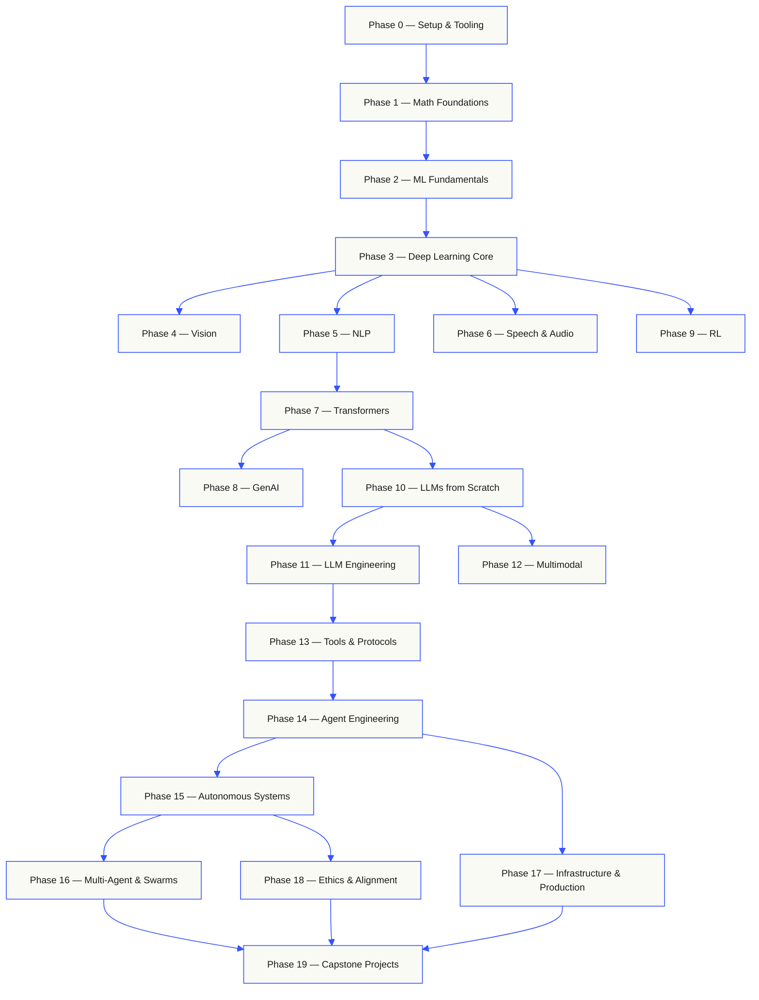

<p align="center">
  <picture>
    <source media="(prefers-color-scheme: dark)" srcset="assets/readme/header-dark.svg">
    
  </picture>
</p>

<p align="center">
 <a href="https://www.star-history.com/rohitg00/ai-engineering-from-scratch">
  <picture><source media="(prefers-color-scheme: dark)" srcset="https://api.star-history.com/badge?repo=rohitg00/ai-engineering-from-scratch&type=rank&theme=dark" /><source media="(prefers-color-scheme: light)" srcset="https://api.star-history.com/badge?repo=rohitg00/ai-engineering-from-scratch&type=rank" /></picture> <picture><source media="(prefers-color-scheme: dark)" srcset="https://api.star-history.com/badge?repo=rohitg00/ai-engineering-from-scratch&type=trending&theme=dark" /><source media="(prefers-color-scheme: light)" srcset="https://api.star-history.com/badge?repo=rohitg00/ai-engineering-from-scratch&type=trending" /></picture>
 </a>
</p>

Implement model internals, retrieval pipelines, and agent runtimes. Test them, inspect failures, and keep the code and evaluation results.

**[Start learning](https://aiengineeringfromscratch.com/lesson?path=phases/00-setup-and-tooling/01-dev-environment)** · **[Choose a path](#learning-routes)** · **[Try a lab](#interactive-lab)** · **[Build a project](#project-challenges)** · **[Browse the curriculum](#contents)**

Free, open source, MIT. Learn on the website, with a coding agent, or by running local code.

> 542 lessons. 20 phases. Python, TypeScript, Rust, Julia, Go.

<p align="center">
  <a href="LICENSE"></a>
  <a href="ROADMAP.md"></a>
  <a href="#contents"></a>
  <a href="https://github.com/rohitg00/ai-engineering-from-scratch/stargazers"></a>
  <a href="https://aiengineeringfromscratch.com"></a>
</p>

<details>
<summary>Read in your language</summary>

<p align="center">
  <a href="README.md">🇬🇧 English</a> ·
  <a href="i18n/zh/README.md">🇨🇳 简体中文</a> ·
  <a href="i18n/zh-TW/README.md">🇹🇼 繁體中文（台灣）</a> ·
  <a href="i18n/ja/README.md">🇯🇵 日本語</a> ·
  <a href="i18n/ko/README.md">🇰🇷 한국어</a> ·
  <a href="i18n/pt/README.md">🇵🇹 Português</a> ·
  <a href="i18n/pt-BR/README.md">🇧🇷 Português (Brasil)</a> ·
  <a href="i18n/es/README.md">🇪🇸 Español</a> ·
  <a href="i18n/de/README.md">🇩🇪 Deutsch</a> ·
  <a href="i18n/fr/README.md">🇫🇷 Français</a> ·
  <a href="i18n/it/README.md">🇮🇹 Italiano</a> ·
  <a href="i18n/nl/README.md">🇳🇱 Nederlands</a> ·
  <a href="i18n/pl/README.md">🇵🇱 Polski</a> ·
  <a href="i18n/cs/README.md">🇨🇿 Čeština</a> ·
  <a href="i18n/ro/README.md">🇷🇴 Română</a> ·
  <a href="i18n/hu/README.md">🇭🇺 Magyar</a> ·
  <a href="i18n/el/README.md">🇬🇷 Ελληνικά</a> ·
  <a href="i18n/sv/README.md">🇸🇪 Svenska</a> ·
  <a href="i18n/da/README.md">🇩🇰 Dansk</a> ·
  <a href="i18n/no/README.md">🇳🇴 Norsk</a> ·
  <a href="i18n/fi/README.md">🇫🇮 Suomi</a> ·
  <a href="i18n/ru/README.md">🇷🇺 Русский</a> ·
  <a href="i18n/uk/README.md">🇺🇦 Українська</a> ·
  <a href="i18n/tr/README.md">🇹🇷 Türkçe</a> ·
  <a href="i18n/he/README.md">🇮🇱 עברית</a> ·
  <a href="i18n/ar/README.md">🇸🇦 العربية</a> ·
  <a href="i18n/fa/README.md">🇮🇷 فارسی</a> ·
  <a href="i18n/hi/README.md">🇮🇳 हिन्दी</a> ·
  <a href="i18n/bn/README.md">🇧🇩 বাংলা</a> ·
  <a href="i18n/ur/README.md">🇵🇰 اردو</a> ·
  <a href="i18n/th/README.md">🇹🇭 ไทย</a> ·
  <a href="i18n/vi/README.md">🇻🇳 Tiếng Việt</a> ·
  <a href="i18n/id/README.md">🇮🇩 Bahasa Indonesia</a> ·
  <a href="i18n/tl/README.md">🇵🇭 Tagalog</a>
</p>

</details>

### Sponsors

<p align="center">
  <a href="https://serpapi.com/ai-engineering-from-scratch"><picture><source media="(min-width: 768px)" srcset="assets/sponsors/serpapi-banner-compact.png" width="48%"></picture></a>
</p>

<p align="center">
  <sub><span>Your support keeps every lesson free and open source.</span> <a href="#supporters">See all supporters</a> · <a href="SPONSORS.md">Become a sponsor</a></sub>
</p>

<a id="see-what-you-will-build-and-keep"></a>
<a id="learning-routes"></a>

## Learning paths

| Route | Starting lesson |
|---|---|
| Model foundations | [Setup and tooling](https://aiengineeringfromscratch.com/lesson?path=phases/00-setup-and-tooling/01-dev-environment) |
| LLM systems | [Prompt engineering](https://aiengineeringfromscratch.com/lesson?path=phases/11-llm-engineering/01-prompt-engineering) |
| Agents and delivery | [The agent loop](https://aiengineeringfromscratch.com/lesson?path=phases/14-agent-engineering/01-the-agent-loop) |

[Compare career paths](https://aiengineeringfromscratch.com/learning-paths.html) · [Prerequisites and study time](#study-guide)

<a id="interactive-lab"></a>

### Gradient descent

Twenty starting points follow gradient descent on a quadratic loss. The graph shows their positions and mean loss after each update.

<p align="center">
  <a href="https://aiengineeringfromscratch.com/lesson?path=phases/01-math-foundations/08-optimization#loss-landscape-visualization">
    <picture>
      <source media="(max-width: 600px) and (prefers-color-scheme: dark) and (prefers-reduced-motion: reduce)" srcset="assets/readme/101-gradient-mobile-dark.png">
      <source media="(max-width: 600px) and (prefers-reduced-motion: reduce)" srcset="assets/readme/101-gradient-mobile-light.png">
      <source media="(prefers-color-scheme: dark) and (prefers-reduced-motion: reduce)" srcset="assets/readme/101-gradient-dark.png">
      <source media="(prefers-reduced-motion: reduce)" srcset="assets/readme/101-gradient-light.png">
      <source media="(max-width: 600px) and (prefers-color-scheme: dark)" srcset="assets/readme/101-gradient-mobile-dark.gif">
      <source media="(max-width: 600px)" srcset="assets/readme/101-gradient-mobile-light.gif">
      <source media="(prefers-color-scheme: dark)" srcset="assets/readme/101-gradient-dark.gif">
      
    </picture>
  </a>
</p>

[Adjust the learning rate in the lesson](https://aiengineeringfromscratch.com/lesson?path=phases/01-math-foundations/08-optimization#loss-landscape-visualization) · [Compare GD, momentum, and Adam in code](phases/01-math-foundations/08-optimization/code/optimizers.py)

<a id="project-challenges"></a>

### Projects

Three projects with staged starters, reference implementations, and local graders. Run commands from the repository root after [setup](#local-setup). Starters fail until you implement the stages.

<details>
<summary><strong>01 · Retrieval Evaluation Lab</strong> · Python · Ranking metrics and regression checks</summary>

A candidate improves mean NDCG while one query ranks its most relevant evidence lower. Build a query-by-query comparison that reports the regression and can fail a release check.

Use Python 3.10+. Review [RAG](phases/11-llm-engineering/06-rag/docs/en.md) and [model evaluation](phases/02-ml-fundamentals/09-model-evaluation/docs/en.md). Implement ranking validation, precision and recall, rank-sensitive metrics, then system comparison.

```bash
python3 scripts/project_test.py retrieval-evaluation-lab \
  --init learning-artifacts/retrieval-evaluation-lab
python3 scripts/project_test.py retrieval-evaluation-lab \
  --stage 1 --path learning-artifacts/retrieval-evaluation-lab --strict
python3 scripts/project_test.py retrieval-evaluation-lab \
  --all --path learning-artifacts/retrieval-evaluation-lab --strict
```

**Keep:** a reproducible comparison with per-query deltas and the judgments used to score them. Metrics describe those judgments; they do not establish answer correctness.

[Start the project](https://aiengineeringfromscratch.com/project.html?id=retrieval-evaluation-lab) · [Inspect the reference](projects/retrieval-evaluation-lab/solution/) · [Run on your own inputs](projects/retrieval-evaluation-lab/README.md#run-with-your-own-inputs)

</details>

<details>
<summary><strong>02 · Agent Trace Debugger</strong> · TypeScript · Trace parsing and timing</summary>

A supplied trace still takes 100 ms, but total token usage rises by 200 and one span starts failing. Separate overlapping child work from parent execution time, then produce a report that exposes the change.

Use Node.js 22.18+ and Python 3 for the grader. Implement JSONL parsing, parent validation, interval arithmetic, then an inspectable timeline.

```bash
python3 scripts/project_test.py agent-trace-debugger \
  --init learning-artifacts/agent-trace-debugger
python3 scripts/project_test.py agent-trace-debugger \
  --stage 1 --path learning-artifacts/agent-trace-debugger --strict
python3 scripts/project_test.py agent-trace-debugger \
  --all --path learning-artifacts/agent-trace-debugger --strict
```

**Keep:** the input trace, an HTML timeline, and a JSON regression report. Preserve exclusive per-span token counts so parent and child usage are not counted twice.

[Start the project](https://aiengineeringfromscratch.com/project.html?id=agent-trace-debugger) · [Inspect the reference](projects/agent-trace-debugger/solution/) · [Explore timing interactively](https://aiengineeringfromscratch.com/project.html?id=agent-trace-debugger&stage=03-timing)

</details>

<details>
<summary><strong>03 · Tool Call Firewall</strong> · Rust · Role checks and approval receipts</summary>

A write changes after review, or an approval is replayed. Validate the call envelope, check the caller's role and path, then consume an approval bound to the exact request and content.

Use Rust and Python 3.10+. Review [tool schema design](phases/13-tools-and-protocols/05-tool-schema-design/docs/en.md) and [security boundaries](phases/17-infrastructure-and-production/25-security-secrets-audit/docs/en.md). The caller application supplies identity; the model proposes an operation.

```bash
python3 scripts/project_test.py tool-call-firewall \
  --init learning-artifacts/tool-call-firewall
python3 scripts/project_test.py tool-call-firewall \
  --stage 1 --path learning-artifacts/tool-call-firewall --strict
python3 scripts/project_test.py tool-call-firewall \
  --all --path learning-artifacts/tool-call-firewall --strict
```

**Keep:** an audit receipt showing the requested operation and the policy decision. Approvals are single-use within one invocation; this project does not provide persistent authorization or an operating-system sandbox.

[Start the project](https://aiengineeringfromscratch.com/project.html?id=tool-call-firewall) · [Inspect the reference](projects/tool-call-firewall/solution/) · [Explore approval boundaries](https://aiengineeringfromscratch.com/project.html?id=tool-call-firewall&stage=03-consume-a-request-bound-approval-once)

</details>

[Browse all projects](https://aiengineeringfromscratch.com/projects.html) · [Career practice guide](learning-paths/CAREER-PRACTICE.md)

## Choose how to learn

### On the website

Open any completed lesson on [aiengineeringfromscratch.com](https://aiengineeringfromscratch.com) or expand a phase under [Contents](#contents). No setup, no cloning.

### With an AI tutor

If Node.js, `npx`, and a skill-capable coding agent are already installed, your coding agent can become your tutor. A repository clone is not needed to install or read the tutor. Runnable focused-path labs need `python3`. Agent Skills host labs also need a selected host and a writable user or project skill scope.

```bash
npx skills add rohitg00/ai-engineering-from-scratch
```

Choose the host and scope when the installer asks. Use `start-learning` in Codex, `/start-learning` in Claude Code, or ask your host to use the skill by name.

<details>
<summary>Tutor setup and host commands</summary>

Check the local requirements first:

```bash
node --version
npx --version
python3 --version
```

`skills` writes to the host and scope selected during installation, such as
`.claude/skills/`, `.cursor/skills/`, `.codex/skills/`, or another supported
skills folder. Verify that the selected host discovers that exact destination.

Invocation syntax belongs to the host, not to the portable `SKILL.md` format:

| Host | Start the course | Start Model Context Protocol (MCP) | Start Agent Skills | Run a phase quiz |
|---|---|---|---|---|
| Codex | `start-learning`, or choose it from `/skills` | `learn-mcp`, or choose it from `/skills` | `learn-agent-skills`, or choose it from `/skills` | `check-understanding 13`, or choose it from `/skills` |
| Claude Code | `/start-learning` | `/learn-mcp` | `/learn-agent-skills` | `/check-understanding 13` |
| Other compatible hosts | `Use start-learning to begin the course.` | `Use learn-mcp to start the Model Context Protocol (MCP) path.` | `Use learn-agent-skills to start the Agent Skills Engineering path.` | `Use check-understanding to quiz me on Phase 13.` |

A ten-question placement quiz maps what you already know to a starting phase and
saves a personalized study plan to `LEARNING.md`. From there, the `learn` skill
teaches one lesson per session: concept, math, code, quiz. It streams lessons
straight from this repo, and the `course-guide` skill jumps you to the exact
lesson that covers anything you are stuck on. In Codex, invoke these skills with
`learn` and `course-guide`; in Claude Code, use `/learn` and `/course-guide`;
in other compatible hosts, ask to use the skill by name.

Only want Model Context Protocol (MCP)? Use the MCP invocation for your host. It creates
`MCP-LEARNING.md` and follows one 17-lesson route through stateless
requests, transports, bidirectional work, security, reliability, registry
governance, and conformance evidence. The exact order and checkpoints live in
the [Model Context Protocol (MCP) manifest](learning-paths/model-context-protocol.json).

Only want Agent Skills? Use the Agent Skills invocation for your host. It
creates `AGENT-SKILLS-LEARNING.md` and follows one coherent five-lesson route:
contract, discovery, invocation, sandbox boundaries, then release evals and
real-host portability. Start on the web with the
[Agent Skills path](https://aiengineeringfromscratch.com/lesson?path=phases/13-tools-and-protocols/22-skills-and-agent-sdks&learningPath=agent-skills).

The installer lists the hosts it can configure and asks where to install. If
you do not have Node.js, `npx`, `python3`, a supported host, or a writable
scope yet, use the website or read `docs/en.md` manually. That path teaches the
concepts, but real-host discovery, invocation, script, and uninstall evidence
remains pending until the preflight is available. Read the lessons at
[aiengineeringfromscratch.com](https://aiengineeringfromscratch.com).

### The learning skills

| Skill | What it does |
|---|---|
| [`start-learning`](skills/start-learning/SKILL.md) | One-time onboarding: why you're learning, placement quiz, personalized plan saved to `LEARNING.md`. |
| [`learn`](skills/learn/SKILL.md) | The tutor loop. Warm-up recall, then the next lesson taught interactively, then its quiz; records progress and a review queue. |
| [`course-guide`](skills/course-guide/SKILL.md) | Topic router. "Where do I learn attention?" or "my loss is NaN" → the exact lessons, with links. |
| [`learn-mcp`](skills/learn-mcp/SKILL.md) | Focused Model Context Protocol (MCP) tutor. Creates `MCP-LEARNING.md`, follows the 17-lesson manifest, and records wire, security, reliability, and conformance evidence. |
| [`learn-agent-skills`](skills/learn-agent-skills/SKILL.md) | Focused Agent Skills tutor. Creates `AGENT-SKILLS-LEARNING.md`, teaches lessons 22, 24, 25, 26, and 27, and records real-host evidence. |
| [`learn-reverse-engineering`](skills/learn-reverse-engineering/SKILL.md) | Focused Reverse Engineering tutor. Creates `REVERSE-ENGINEERING-LEARNING.md`, teaches Phase 13 lessons 32 to 45 on programs you build yourself, and records lab evidence. |
| [`claude-certification`](skills/claude-certification/SKILL.md) | Certification tutor. Chooses CCAO-F, CCDV-F, CCAR-F, or CCAR-P; teaches each lesson; runs labs; reviews artifacts; administers diagnostics and mocks; saves progress. |
| [`mcpa-certification`](skills/mcpa-certification/SKILL.md) | MCPA tutor. Follows the 34-lesson `mcpa-f` route on the 2026-07-28 protocol; teaches each lesson; runs labs and the wire checker; administers the diagnostic and three mocks; saves progress. |
| [`find-your-level`](skills/find-your-level/SKILL.md) | Ten-question placement quiz. Maps your knowledge to a starting phase and produces a personalized path with hour estimates. |
| [`check-understanding <phase>`](skills/check-understanding/SKILL.md) | Per-phase quiz, eight questions, with feedback and specific lessons to review. Use the Codex, Claude Code, or natural-language form in the invocation table above. |

</details>

<a id="local-setup"></a>

### Run local code

```bash
git clone https://github.com/rohitg00/ai-engineering-from-scratch.git
cd ai-engineering-from-scratch
python3 phases/00-setup-and-tooling/01-dev-environment/code/verify.py --route beginner
python3 phases/01-math-foundations/01-linear-algebra-intuition/code/vectors.py
```

The preflight separates requirements needed now from tools needed later. Every
required failure includes the detected reason and a corrective command. The
`vectors.py` command is a dependency-free lesson and ends by showing that a matrix
times a vector is the operation inside a neural network layer. Save that
terminal output as your first evidence.

<details>
<summary>Use every lesson the same way</summary>

### Use every lesson the same way

1. **Read** `docs/en.md` and explain the core idea in your own words.
2. **Type and build** the important code instead of treating the code block as decoration.
3. **Run** the lesson command from the repository root, the directory containing `README.md` and `phases/`.
4. **Keep evidence**: the command, working directory, exit code, meaningful output, and the artifact you changed or produced.
5. **Continue** only when you can explain the output and make one small change without guessing.

Commands in lesson pages are paths from the repository root unless the lesson
explicitly says to change directories. If a lesson offers several languages,
run the implementation for the language you are learning.

</details>

<a id="study-guide"></a>

## Choose a learning path

You do not need to scan 542 lessons before beginning. Pick one goal. Each link
opens the same curriculum on GitHub or the website, and both versions use the
same lesson code.

| Your goal | Learn on GitHub | Learn on the website |
|---|---|---|
| I am new and want the complete foundation | [Phase 0: Setup and Tooling](phases/00-setup-and-tooling/) | [Dev Environment](https://aiengineeringfromscratch.com/lesson?path=phases/00-setup-and-tooling/01-dev-environment) |
| I know Python and want math plus ML foundations | [Phase 1: Math Foundations](phases/01-math-foundations/) | [Linear Algebra Intuition](https://aiengineeringfromscratch.com/lesson?path=phases/01-math-foundations/01-linear-algebra-intuition) |
| I want to build production LLM applications | [Phase 11: LLM Engineering](phases/11-llm-engineering/) | [Prompt Engineering](https://aiengineeringfromscratch.com/lesson?path=phases/11-llm-engineering/01-prompt-engineering) |
| I want to build agents | [Phase 14: Agent Engineering](phases/14-agent-engineering/) | [The Agent Loop](https://aiengineeringfromscratch.com/lesson?path=phases/14-agent-engineering/01-the-agent-loop) |
| I want to use coding agents on real repositories | [Agent-Assisted Engineering path](learning-paths/using-coding-agents.json) | [Agent-Assisted Engineering](https://aiengineeringfromscratch.com/lesson?path=phases/14-agent-engineering/31-agent-workbench-why-models-fail&learningPath=using-coding-agents) |
| I want to shape the right build before implementation | [Product Judgment and Delivery path](learning-paths/shaping-the-build.json) | [Product Judgment and Delivery](https://aiengineeringfromscratch.com/lesson?path=phases/14-agent-engineering/47-outcomes-before-output&learningPath=shaping-the-build) |

Not sure where you fit? Use the [`start-learning` placement tutor](skills/start-learning/SKILL.md)
or the [website prerequisites guide](https://aiengineeringfromscratch.com/prereqs.html).

Compare four core domains and six career routes in the [AI Engineering Learning Paths](https://aiengineeringfromscratch.com/learning-paths.html).

<details>
<summary>Focused MCP, Agent Skills, and Reverse Engineering paths</summary>

| Your goal | Learn on GitHub | Learn on the website |
|---|---|---|
| I want to build with Model Context Protocol (MCP) | [Model Context Protocol (MCP) route](phases/13-tools-and-protocols/README.md#model-context-protocol-mcp-path) | [Model Context Protocol (MCP) path](https://aiengineeringfromscratch.com/lesson?path=phases/13-tools-and-protocols/06-mcp-fundamentals&learningPath=model-context-protocol) |
| I want to write and ship Agent Skills | [Focused Agent Skills route](phases/13-tools-and-protocols/README.md#agent-skills-fast-path) | [Agent Skills path](https://aiengineeringfromscratch.com/lesson?path=phases/13-tools-and-protocols/22-skills-and-agent-sdks&learningPath=agent-skills) |
| I want to read compiled programs | [Reverse Engineering route](phases/13-tools-and-protocols/README.md#reverse-engineering-path) | [Reverse Engineering path](https://aiengineeringfromscratch.com/lesson?path=phases/13-tools-and-protocols/32-program-anatomy-elf-from-scratch&learningPath=reverse-engineering) |

</details>

<details>
<summary>Prerequisites and study time</summary>

### Prerequisites

- You can write code (any language; Python helps).
- You want to understand how AI **actually works**, not just call APIs.

## Where to start

| Background | Start at | Estimated time |
|---|---|---|
| New to programming and AI | Phase 0 — Setup | ~306 hours |
| Know Python, new to ML | Phase 1 — Math Foundations | ~270 hours |
| Know ML, new to deep learning | Phase 3 — Deep Learning Core | ~200 hours |
| Know deep learning, want LLMs and agents | Phase 10 — LLMs from Scratch | ~100 hours |
| Senior engineer, only want agent engineering | Phase 14 — Agent Engineering | ~60 hours |
| Only want to build production MCP systems | [Model Context Protocol (MCP) path](learning-paths/model-context-protocol.json) | ~23 hours 15 min |
| Only want to build production Agent Skills | [Agent Skills Engineering path](learning-paths/agent-skills.json) | ~9.5 hours |
| Only want to learn reverse engineering | [Reverse Engineering path](learning-paths/reverse-engineering.json) | ~32.5 hours |

</details>

## The shape of the curriculum

Twenty phases stack on top of each other. Math is the floor. Agents and production are the roof.
Skip ahead if you already know the lower layers, but don't skip and then wonder why something at
the top is breaking.



<a id="contents"></a>

## Contents

Twenty phases. Click any phase to expand its lesson list.

<a id="phase-0"></a>
### Phase 0: Setup & Tooling `13 lessons`
> Get your environment ready for everything that follows.

| # | Lesson | Type | Lang |
|:---:|--------|:----:|------|
| 01 | [Dev Environment](phases/00-setup-and-tooling/01-dev-environment/) | Build | Python, TypeScript, Rust |
| 02 | [Git & Collaboration](phases/00-setup-and-tooling/02-git-and-collaboration/) | Learn | — |
| 03 | [GPU Setup & Cloud](phases/00-setup-and-tooling/03-gpu-setup-and-cloud/) | Build | Python |
| 04 | [APIs & Keys](phases/00-setup-and-tooling/04-apis-and-keys/) | Build | Python, TypeScript |
| 05 | [Jupyter Notebooks](phases/00-setup-and-tooling/05-jupyter-notebooks/) | Build | Python |
| 06 | [Python Environments](phases/00-setup-and-tooling/06-python-environments/) | Build | Shell |
| 07 | [Docker for AI](phases/00-setup-and-tooling/07-docker-for-ai/) | Build | Docker |
| 08 | [Editor Setup](phases/00-setup-and-tooling/08-editor-setup/) | Build | — |
| 09 | [Data Management](phases/00-setup-and-tooling/09-data-management/) | Build | Python |
| 10 | [Terminal & Shell](phases/00-setup-and-tooling/10-terminal-and-shell/) | Learn | — |
| 11 | [Linux for AI](phases/00-setup-and-tooling/11-linux-for-ai/) | Learn | — |
| 12 | [Debugging & Profiling](phases/00-setup-and-tooling/12-debugging-and-profiling/) | Build | Python |
| 13 | [Python for AI Engineering](phases/00-setup-and-tooling/13-python-for-ai-engineering/) | Build | Python, TypeScript |

<details id="phase-1">
<summary><b>Phase 1 — Math Foundations</b> &nbsp;<code>22 lessons</code>&nbsp; <em>The intuition behind every AI algorithm, through code.</em></summary>
<br/>

| # | Lesson | Type | Lang |
|:---:|--------|:----:|------|
| 01 | [Linear Algebra Intuition](phases/01-math-foundations/01-linear-algebra-intuition/) | Learn | Python, Julia |
| 02 | [Vectors, Matrices & Operations](phases/01-math-foundations/02-vectors-matrices-operations/) | Build | Python, Julia |
| 03 | [Matrix Transformations & Eigenvalues](phases/01-math-foundations/03-matrix-transformations/) | Build | Python, Julia |
| 04 | [Calculus for ML: Derivatives & Gradients](phases/01-math-foundations/04-calculus-for-ml/) | Learn | Python, Julia |
| 05 | [Chain Rule & Automatic Differentiation](phases/01-math-foundations/05-chain-rule-and-autodiff/) | Build | Python, Julia |
| 06 | [Probability & Distributions](phases/01-math-foundations/06-probability-and-distributions/) | Learn | Python, Julia |
| 07 | [Bayes' Theorem & Statistical Thinking](phases/01-math-foundations/07-bayes-theorem/) | Build | Python, TypeScript |
| 08 | [Optimization: Gradient Descent Family](phases/01-math-foundations/08-optimization/) | Build | Python, Julia |
| 09 | [Information Theory: Entropy, KL Divergence](phases/01-math-foundations/09-information-theory/) | Learn | Python, TypeScript |
| 10 | [Dimensionality Reduction: PCA, t-SNE, UMAP](phases/01-math-foundations/10-dimensionality-reduction/) | Build | Python, TypeScript, Julia |
| 11 | [Singular Value Decomposition](phases/01-math-foundations/11-singular-value-decomposition/) | Build | Python, Julia |
| 12 | [Tensor Operations](phases/01-math-foundations/12-tensor-operations/) | Build | Python, TypeScript |
| 13 | [Numerical Stability](phases/01-math-foundations/13-numerical-stability/) | Build | Python, TypeScript, Julia |
| 14 | [Norms & Distances](phases/01-math-foundations/14-norms-and-distances/) | Build | Python, TypeScript |
| 15 | [Statistics for ML](phases/01-math-foundations/15-statistics-for-ml/) | Build | Python, TypeScript |
| 16 | [Sampling Methods](phases/01-math-foundations/16-sampling-methods/) | Build | Python, TypeScript, Julia |
| 17 | [Linear Systems](phases/01-math-foundations/17-linear-systems/) | Build | Python, TypeScript, Julia |
| 18 | [Convex Optimization](phases/01-math-foundations/18-convex-optimization/) | Build | Python, TypeScript, Julia |
| 19 | [Complex Numbers for AI](phases/01-math-foundations/19-complex-numbers/) | Learn | Python, TypeScript |
| 20 | [The Fourier Transform](phases/01-math-foundations/20-fourier-transform/) | Build | Python, TypeScript, Julia |
| 21 | [Graph Theory for ML](phases/01-math-foundations/21-graph-theory/) | Build | Python, TypeScript |
| 22 | [Stochastic Processes](phases/01-math-foundations/22-stochastic-processes/) | Learn | Python, Julia |

</details>

<details id="phase-2">
<summary><b>Phase 2 — ML Fundamentals</b> &nbsp;<code>21 lessons</code>&nbsp; <em>Classical ML — still the backbone of most production AI.</em></summary>
<br/>

| # | Lesson | Type | Lang |
|:---:|--------|:----:|------|
| 01 | [What Is Machine Learning](phases/02-ml-fundamentals/01-what-is-machine-learning/) | Learn | Python |
| 02 | [Linear Regression from Scratch](phases/02-ml-fundamentals/02-linear-regression/) | Build | Python, Rust, Julia |
| 03 | [Logistic Regression & Classification](phases/02-ml-fundamentals/03-logistic-regression/) | Build | Python, Rust, Julia |
| 04 | [Decision Trees & Random Forests](phases/02-ml-fundamentals/04-decision-trees/) | Build | Python, TypeScript |
| 05 | [Support Vector Machines](phases/02-ml-fundamentals/05-support-vector-machines/) | Build | Python, Julia |
| 06 | [KNN & Distance Metrics](phases/02-ml-fundamentals/06-knn-and-distances/) | Build | Python, TypeScript |
| 07 | [Unsupervised Learning: K-Means, DBSCAN](phases/02-ml-fundamentals/07-unsupervised-learning/) | Build | Python, TypeScript |
| 08 | [Feature Engineering & Selection](phases/02-ml-fundamentals/08-feature-engineering/) | Build | Python, TypeScript |
| 09 | [Model Evaluation: Metrics, Cross-Validation](phases/02-ml-fundamentals/09-model-evaluation/) | Build | Python, Julia |
| 10 | [Bias, Variance & the Learning Curve](phases/02-ml-fundamentals/10-bias-variance/) | Learn | Python |
| 11 | [Ensemble Methods: Boosting, Bagging, Stacking](phases/02-ml-fundamentals/11-ensemble-methods/) | Build | Python |
| 12 | [Hyperparameter Tuning](phases/02-ml-fundamentals/12-hyperparameter-tuning/) | Build | Python |
| 13 | [ML Pipelines & Experiment Tracking](phases/02-ml-fundamentals/13-ml-pipelines/) | Build | Python |
| 14 | [Naive Bayes](phases/02-ml-fundamentals/14-naive-bayes/) | Build | Python |
| 15 | [Time Series Fundamentals](phases/02-ml-fundamentals/15-time-series/) | Build | Python |
| 16 | [Anomaly Detection](phases/02-ml-fundamentals/16-anomaly-detection/) | Build | Python |
| 17 | [Handling Imbalanced Data](phases/02-ml-fundamentals/17-imbalanced-data/) | Build | Python |
| 18 | [Feature Selection](phases/02-ml-fundamentals/18-feature-selection/) | Build | Python |
| 19 | [ML System Design — From Problem to Deployed Model](phases/02-ml-fundamentals/19-ml-system-design/) | Build | Python, TypeScript |
| 20 | [Monitoring Models in Production — Data Drift and Concept Drift](phases/02-ml-fundamentals/20-model-monitoring-and-drift/) | Build | Python, TypeScript |
| 21 | [Feature Stores and Training-Serving Skew](phases/02-ml-fundamentals/21-feature-stores-and-training-serving-skew/) | Build | Python, TypeScript |

</details>

<details id="phase-3">
<summary><b>Phase 3 — Deep Learning Core</b> &nbsp;<code>13 lessons</code>&nbsp; <em>Neural networks from first principles. No frameworks until you build one.</em></summary>
<br/>

| # | Lesson | Type | Lang |
|:---:|--------|:----:|------|
| 01 | [The Perceptron: Where It All Started](phases/03-deep-learning-core/01-the-perceptron/) | Build | Python, TypeScript, Rust, Julia |
| 02 | [Multi-Layer Networks & Forward Pass](phases/03-deep-learning-core/02-multi-layer-networks/) | Build | Python, TypeScript, Julia |
| 03 | [Backpropagation from Scratch](phases/03-deep-learning-core/03-backpropagation/) | Build | Python, TypeScript, Rust, Julia |
| 04 | [Activation Functions: ReLU, Sigmoid, GELU & Why](phases/03-deep-learning-core/04-activation-functions/) | Build | Python, TypeScript, Julia |
| 05 | [Loss Functions: MSE, Cross-Entropy, Contrastive](phases/03-deep-learning-core/05-loss-functions/) | Build | Python, TypeScript, Julia |
| 06 | [Optimizers: SGD, Momentum, Adam, AdamW](phases/03-deep-learning-core/06-optimizers/) | Build | Python, TypeScript, Julia |
| 07 | [Regularization: Dropout, Weight Decay, BatchNorm](phases/03-deep-learning-core/07-regularization/) | Build | Python, TypeScript, Julia |
| 08 | [Weight Initialization & Training Stability](phases/03-deep-learning-core/08-weight-initialization/) | Build | Python, TypeScript, Julia |
| 09 | [Learning Rate Schedules & Warmup](phases/03-deep-learning-core/09-learning-rate-schedules/) | Build | Python, TypeScript, Julia |
| 10 | [Build Your Own Mini Framework](phases/03-deep-learning-core/10-mini-framework/) | Build | Python, TypeScript, Julia |
| 11 | [Introduction to PyTorch](phases/03-deep-learning-core/11-intro-to-pytorch/) | Build | Python |
| 12 | [Introduction to JAX](phases/03-deep-learning-core/12-intro-to-jax/) | Build | Python |
| 13 | [Debugging Neural Networks](phases/03-deep-learning-core/13-debugging-neural-networks/) | Build | Python |

</details>

<details id="phase-4">
<summary><b>Phase 4 — Computer Vision</b> &nbsp;<code>28 lessons</code>&nbsp; <em>From pixels to understanding — image, video, 3D, VLMs, and world models.</em></summary>
<br/>

| # | Lesson | Type | Lang |
|:---:|--------|:----:|------|
| 01 | [Image Fundamentals: Pixels, Channels, Color Spaces](phases/04-computer-vision/01-image-fundamentals/) | Learn | Python, Julia |
| 02 | [Convolutions from Scratch](phases/04-computer-vision/02-convolutions-from-scratch/) | Build | Python, Julia |
| 03 | [CNNs: LeNet to ResNet](phases/04-computer-vision/03-cnns-lenet-to-resnet/) | Build | Python |
| 04 | [Image Classification](phases/04-computer-vision/04-image-classification/) | Build | Python |
| 05 | [Transfer Learning & Fine-Tuning](phases/04-computer-vision/05-transfer-learning/) | Build | Python |
| 06 | [Object Detection — YOLO from Scratch](phases/04-computer-vision/06-object-detection-yolo/) | Build | Python |
| 07 | [Semantic Segmentation — U-Net](phases/04-computer-vision/07-semantic-segmentation-unet/) | Build | Python |
| 08 | [Instance Segmentation — Mask R-CNN](phases/04-computer-vision/08-instance-segmentation-mask-rcnn/) | Build | Python |
| 09 | [Image Generation — GANs](phases/04-computer-vision/09-image-generation-gans/) | Build | Python |
| 10 | [Image Generation — Diffusion Models](phases/04-computer-vision/10-image-generation-diffusion/) | Build | Python |
| 11 | [Stable Diffusion — Architecture & Fine-Tuning](phases/04-computer-vision/11-stable-diffusion/) | Build | Python |
| 12 | [Video Understanding — Temporal Modeling](phases/04-computer-vision/12-video-understanding/) | Build | Python |
| 13 | [3D Vision: Point Clouds, NeRFs](phases/04-computer-vision/13-3d-vision-nerf/) | Build | Python |
| 14 | [Vision Transformers (ViT)](phases/04-computer-vision/14-vision-transformers/) | Build | Python |
| 15 | [Real-Time Vision: Edge Deployment](phases/04-computer-vision/15-real-time-edge/) | Build | Python, Rust |
| 16 | [Build a Complete Vision Pipeline](phases/04-computer-vision/16-vision-pipeline-capstone/) | Build | Python |
| 17 | [Self-Supervised Vision — SimCLR, DINO, MAE](phases/04-computer-vision/17-self-supervised-vision/) | Build | Python |
| 18 | [Open-Vocabulary Vision — CLIP](phases/04-computer-vision/18-open-vocab-clip/) | Build | Python |
| 19 | [OCR & Document Understanding](phases/04-computer-vision/19-ocr-document-understanding/) | Build | Python |
| 20 | [Image Retrieval & Metric Learning](phases/04-computer-vision/20-image-retrieval-metric/) | Build | Python |
| 21 | [Keypoint Detection & Pose Estimation](phases/04-computer-vision/21-keypoint-pose/) | Build | Python |
| 22 | [3D Gaussian Splatting from Scratch](phases/04-computer-vision/22-3d-gaussian-splatting/) | Build | Python |
| 23 | [Diffusion Transformers & Rectified Flow](phases/04-computer-vision/23-diffusion-transformers-rectified-flow/) | Build | Python |
| 24 | [SAM 3 & Open-Vocabulary Segmentation](phases/04-computer-vision/24-sam3-open-vocab-segmentation/) | Build | Python |
| 25 | [Vision-Language Models (ViT-MLP-LLM)](phases/04-computer-vision/25-vision-language-models/) | Build | Python |
| 26 | [Monocular Depth & Geometry Estimation](phases/04-computer-vision/26-monocular-depth/) | Build | Python |
| 27 | [Multi-Object Tracking & Video Memory](phases/04-computer-vision/27-multi-object-tracking/) | Build | Python, Rust |
| 28 | [World Models & Video Diffusion](phases/04-computer-vision/28-world-models-video-diffusion/) | Build | Python |

</details>

<details id="phase-5">
<summary><b>Phase 5 — NLP: Foundations to Advanced</b> &nbsp;<code>29 lessons</code>&nbsp; <em>Language is the interface to intelligence.</em></summary>
<br/>

| # | Lesson | Type | Lang |
|:---:|--------|:----:|------|
| 01 | [Text Processing: Tokenization, Stemming, Lemmatization](phases/05-nlp-foundations-to-advanced/01-text-processing/) | Build | Python, TypeScript |
| 02 | [Bag of Words, TF-IDF & Text Representation](phases/05-nlp-foundations-to-advanced/02-bag-of-words-tfidf/) | Build | Python, TypeScript |
| 03 | [Word Embeddings: Word2Vec from Scratch](phases/05-nlp-foundations-to-advanced/03-word-embeddings-word2vec/) | Build | Python, Julia |
| 04 | [GloVe, FastText & Subword Embeddings](phases/05-nlp-foundations-to-advanced/04-glove-fasttext-subword/) | Build | Python, TypeScript |
| 05 | [Sentiment Analysis](phases/05-nlp-foundations-to-advanced/05-sentiment-analysis/) | Build | Python, TypeScript |
| 06 | [Named Entity Recognition (NER)](phases/05-nlp-foundations-to-advanced/06-named-entity-recognition/) | Build | Python, TypeScript |
| 07 | [POS Tagging & Syntactic Parsing](phases/05-nlp-foundations-to-advanced/07-pos-tagging-parsing/) | Build | Python, TypeScript |
| 08 | [Text Classification — CNNs & RNNs for Text](phases/05-nlp-foundations-to-advanced/08-cnns-rnns-for-text/) | Build | Python, TypeScript |
| 09 | [Sequence-to-Sequence Models](phases/05-nlp-foundations-to-advanced/09-sequence-to-sequence/) | Build | Python, TypeScript |
| 10 | [Attention Mechanism — The Breakthrough](phases/05-nlp-foundations-to-advanced/10-attention-mechanism/) | Build | Python, TypeScript |
| 11 | [Machine Translation](phases/05-nlp-foundations-to-advanced/11-machine-translation/) | Build | Python, TypeScript |
| 12 | [Text Summarization](phases/05-nlp-foundations-to-advanced/12-text-summarization/) | Build | Python, TypeScript |
| 13 | [Question Answering Systems](phases/05-nlp-foundations-to-advanced/13-question-answering/) | Build | Python, TypeScript |
| 14 | [Information Retrieval & Search](phases/05-nlp-foundations-to-advanced/14-information-retrieval-search/) | Build | Python, TypeScript, Rust |
| 15 | [Topic Modeling: LDA, BERTopic](phases/05-nlp-foundations-to-advanced/15-topic-modeling/) | Build | Python, TypeScript, Julia |
| 16 | [Text Generation](phases/05-nlp-foundations-to-advanced/16-text-generation-pre-transformer/) | Build | Python, TypeScript |
| 17 | [Chatbots: Rule-Based to Neural](phases/05-nlp-foundations-to-advanced/17-chatbots-rule-to-neural/) | Build | Python, TypeScript |
| 18 | [Multilingual NLP](phases/05-nlp-foundations-to-advanced/18-multilingual-nlp/) | Build | Python, TypeScript |
| 19 | [Subword Tokenization: BPE, WordPiece, Unigram, SentencePiece](phases/05-nlp-foundations-to-advanced/19-subword-tokenization/) | Learn | Python, TypeScript, Rust |
| 20 | [Structured Outputs & Constrained Decoding](phases/05-nlp-foundations-to-advanced/20-structured-outputs-constrained-decoding/) | Build | Python, TypeScript, Rust |
| 21 | [NLI & Textual Entailment](phases/05-nlp-foundations-to-advanced/21-nli-textual-entailment/) | Learn | Python, TypeScript |
| 22 | [Embedding Models Deep Dive](phases/05-nlp-foundations-to-advanced/22-embedding-models-deep-dive/) | Learn | Python, TypeScript |
| 23 | [Chunking Strategies for RAG](phases/05-nlp-foundations-to-advanced/23-chunking-strategies-rag/) | Build | Python, TypeScript |
| 24 | [Coreference Resolution](phases/05-nlp-foundations-to-advanced/24-coreference-resolution/) | Learn | Python, TypeScript |
| 25 | [Entity Linking & Disambiguation](phases/05-nlp-foundations-to-advanced/25-entity-linking/) | Build | Python, TypeScript |
| 26 | [Relation Extraction & Knowledge Graph Construction](phases/05-nlp-foundations-to-advanced/26-relation-extraction-kg/) | Build | Python, TypeScript |
| 27 | [LLM Evaluation: RAGAS, DeepEval, G-Eval](phases/05-nlp-foundations-to-advanced/27-llm-evaluation-frameworks/) | Build | Python, TypeScript |
| 28 | [Long-Context Evaluation: NIAH, RULER, LongBench, MRCR](phases/05-nlp-foundations-to-advanced/28-long-context-evaluation/) | Learn | Python, TypeScript |
| 29 | [Dialogue State Tracking](phases/05-nlp-foundations-to-advanced/29-dialogue-state-tracking/) | Build | Python, TypeScript |

</details>

<details id="phase-6">
<summary><b>Phase 6 — Speech & Audio</b> &nbsp;<code>17 lessons</code>&nbsp; <em>Hear, understand, speak.</em></summary>
<br/>

| # | Lesson | Type | Lang |
|:---:|--------|:----:|------|
| 01 | [Audio Fundamentals: Waveforms, Sampling, FFT](phases/06-speech-and-audio/01-audio-fundamentals) | Learn | Python, TypeScript, Julia |
| 02 | [Spectrograms, Mel Scale & Audio Features](phases/06-speech-and-audio/02-spectrograms-mel-features) | Build | Python, TypeScript, Julia |
| 03 | [Audio Classification](phases/06-speech-and-audio/03-audio-classification) | Build | Python, TypeScript |
| 04 | [Speech Recognition (ASR)](phases/06-speech-and-audio/04-speech-recognition-asr) | Build | Python, TypeScript |
| 05 | [Whisper: Architecture & Fine-Tuning](phases/06-speech-and-audio/05-whisper-architecture-finetuning) | Build | Python, TypeScript |
| 06 | [Speaker Recognition & Verification](phases/06-speech-and-audio/06-speaker-recognition-verification) | Build | Python, TypeScript |
| 07 | [Text-to-Speech (TTS)](phases/06-speech-and-audio/07-text-to-speech) | Build | Python, TypeScript |
| 08 | [Voice Cloning & Voice Conversion](phases/06-speech-and-audio/08-voice-cloning-conversion) | Build | Python, TypeScript |
| 09 | [Music Generation](phases/06-speech-and-audio/09-music-generation) | Build | Python, TypeScript |
| 10 | [Audio-Language Models](phases/06-speech-and-audio/10-audio-language-models) | Build | Python, TypeScript |
| 11 | [Real-Time Audio Processing](phases/06-speech-and-audio/11-real-time-audio-processing) | Build | Python, Rust |
| 12 | [Build a Voice Assistant Pipeline](phases/06-speech-and-audio/12-voice-assistant-pipeline) | Build | Python, TypeScript |
| 13 | [Neural Audio Codecs — EnCodec, SNAC, Mimi, DAC](phases/06-speech-and-audio/13-neural-audio-codecs) | Learn | Python, TypeScript |
| 14 | [Voice Activity Detection & Turn-Taking](phases/06-speech-and-audio/14-voice-activity-detection-turn-taking) | Build | Python, TypeScript, Rust |
| 15 | [Streaming Speech-to-Speech — Moshi, Hibiki](phases/06-speech-and-audio/15-streaming-speech-to-speech-moshi-hibiki) | Learn | Python, TypeScript |
| 16 | [Voice Anti-Spoofing & Audio Watermarking](phases/06-speech-and-audio/16-anti-spoofing-audio-watermarking) | Build | Python, TypeScript |
| 17 | [Audio Evaluation — WER, MOS, MMAU, Leaderboards](phases/06-speech-and-audio/17-audio-evaluation-metrics) | Learn | Python, TypeScript |

</details>

<details id="phase-7">
<summary><b>Phase 7 — Transformers Deep Dive</b> &nbsp;<code>16 lessons</code>&nbsp; <em>The architecture that changed everything.</em></summary>
<br/>

| # | Lesson | Type | Lang |
|:---:|--------|:----:|------|
| 01 | [Why Transformers: The Problems with RNNs](phases/07-transformers-deep-dive/01-why-transformers/) | Learn | Python, Julia |
| 02 | [Self-Attention from Scratch](phases/07-transformers-deep-dive/02-self-attention-from-scratch/) | Build | Python, Rust, Julia |
| 03 | [Multi-Head Attention](phases/07-transformers-deep-dive/03-multi-head-attention/) | Build | Python, Rust |
| 04 | [Positional Encoding: Sinusoidal, RoPE, ALiBi](phases/07-transformers-deep-dive/04-positional-encoding/) | Build | Python, Rust, Julia |
| 05 | [The Full Transformer: Encoder + Decoder](phases/07-transformers-deep-dive/05-full-transformer/) | Build | Python, Julia |
| 06 | [BERT — Masked Language Modeling](phases/07-transformers-deep-dive/06-bert-masked-language-modeling/) | Build | Python, Rust |
| 07 | [GPT — Causal Language Modeling](phases/07-transformers-deep-dive/07-gpt-causal-language-modeling/) | Build | Python, Rust |
| 08 | [T5, BART — Encoder-Decoder Models](phases/07-transformers-deep-dive/08-t5-bart-encoder-decoder/) | Learn | Python, Rust |
| 09 | [Vision Transformers (ViT)](phases/07-transformers-deep-dive/09-vision-transformers/) | Build | Python, Rust |
| 10 | [Audio Transformers — Whisper Architecture](phases/07-transformers-deep-dive/10-audio-transformers-whisper/) | Learn | Python, Rust |
| 11 | [Mixture of Experts (MoE)](phases/07-transformers-deep-dive/11-mixture-of-experts/) | Build | Python, Rust |
| 12 | [KV Cache, Flash Attention & Inference Optimization](phases/07-transformers-deep-dive/12-kv-cache-flash-attention/) | Build | Python, Rust |
| 13 | [Scaling Laws](phases/07-transformers-deep-dive/13-scaling-laws/) | Learn | Python, Rust |
| 14 | [Build a Transformer from Scratch](phases/07-transformers-deep-dive/14-build-a-transformer-capstone/) | Build | Python |
| 15 | [Attention Variants — Sliding Window, Sparse, Differential](phases/07-transformers-deep-dive/15-attention-variants/) | Build | Python, Rust |
| 16 | [Speculative Decoding — Draft, Verify, Repeat](phases/07-transformers-deep-dive/16-speculative-decoding/) | Build | Python, Rust |

</details>

<details id="phase-8">
<summary><b>Phase 8 — Generative AI</b> &nbsp;<code>15 lessons</code>&nbsp; <em>Create images, video, audio, 3D, and more.</em></summary>
<br/>

| # | Lesson | Type | Lang |
|:---:|--------|:----:|------|
| 01 | [Generative Models: Taxonomy & History](phases/08-generative-ai/01-generative-models-taxonomy-history/) | Learn | Python, TypeScript |
| 02 | [Autoencoders & VAE](phases/08-generative-ai/02-autoencoders-vae/) | Build | Python, TypeScript |
| 03 | [GANs: Generator vs Discriminator](phases/08-generative-ai/03-gans-generator-discriminator/) | Build | Python, TypeScript |
| 04 | [Conditional GANs & Pix2Pix](phases/08-generative-ai/04-conditional-gans-pix2pix/) | Build | Python, TypeScript |
| 05 | [StyleGAN](phases/08-generative-ai/05-stylegan/) | Build | Python, TypeScript |
| 06 | [Diffusion Models — DDPM from Scratch](phases/08-generative-ai/06-diffusion-ddpm-from-scratch/) | Build | Python, TypeScript |
| 07 | [Latent Diffusion & Stable Diffusion](phases/08-generative-ai/07-latent-diffusion-stable-diffusion/) | Build | Python, TypeScript |
| 08 | [ControlNet, LoRA & Conditioning](phases/08-generative-ai/08-controlnet-lora-conditioning/) | Build | Python, TypeScript |
| 09 | [Inpainting, Outpainting & Editing](phases/08-generative-ai/09-inpainting-outpainting-editing/) | Build | Python, TypeScript |
| 10 | [Video Generation](phases/08-generative-ai/10-video-generation/) | Build | Python, TypeScript |
| 11 | [Audio Generation](phases/08-generative-ai/11-audio-generation/) | Build | Python, TypeScript |
| 12 | [3D Generation](phases/08-generative-ai/12-3d-generation/) | Build | Python, TypeScript |
| 13 | [Flow Matching & Rectified Flows](phases/08-generative-ai/13-flow-matching-rectified-flows/) | Build | Python, TypeScript, Julia |
| 14 | [Evaluation: FID, CLIP Score](phases/08-generative-ai/14-evaluation-fid-clip-score/) | Build | Python, TypeScript |
| 19 | [Visual Autoregressive Modeling (VAR): Next-Scale Prediction](phases/08-generative-ai/19-visual-autoregressive-var/) | Build | Python, Julia |

</details>

<details id="phase-9">
<summary><b>Phase 9 — Reinforcement Learning</b> &nbsp;<code>12 lessons</code>&nbsp; <em>The foundation of RLHF and game-playing AI.</em></summary>
<br/>

| # | Lesson | Type | Lang |
|:---:|--------|:----:|------|
| 01 | [MDPs, States, Actions & Rewards](phases/09-reinforcement-learning/01-mdps-states-actions-rewards/) | Learn | Python, TypeScript |
| 02 | [Dynamic Programming](phases/09-reinforcement-learning/02-dynamic-programming/) | Build | Python, TypeScript |
| 03 | [Monte Carlo Methods](phases/09-reinforcement-learning/03-monte-carlo-methods/) | Build | Python, TypeScript |
| 04 | [Q-Learning, SARSA](phases/09-reinforcement-learning/04-q-learning-sarsa/) | Build | Python, TypeScript |
| 05 | [Deep Q-Networks (DQN)](phases/09-reinforcement-learning/05-dqn/) | Build | Python, TypeScript |
| 06 | [Policy Gradients — REINFORCE](phases/09-reinforcement-learning/06-policy-gradients-reinforce/) | Build | Python, TypeScript |
| 07 | [Actor-Critic — A2C, A3C](phases/09-reinforcement-learning/07-actor-critic-a2c-a3c/) | Build | Python, TypeScript |
| 08 | [PPO](phases/09-reinforcement-learning/08-ppo/) | Build | Python, TypeScript |
| 09 | [Reward Modeling & RLHF](phases/09-reinforcement-learning/09-reward-modeling-rlhf/) | Build | Python, TypeScript |
| 10 | [Multi-Agent RL](phases/09-reinforcement-learning/10-multi-agent-rl/) | Build | Python, TypeScript |
| 11 | [Sim-to-Real Transfer](phases/09-reinforcement-learning/11-sim-to-real-transfer/) | Build | Python, TypeScript |
| 12 | [RL for Games](phases/09-reinforcement-learning/12-rl-for-games/) | Build | Python, TypeScript |

</details>

<details id="phase-10">
<summary><b>Phase 10 — LLMs from Scratch</b> &nbsp;<code>24 lessons</code>&nbsp; <em>Build, train, and understand large language models.</em></summary>
<br/>

| # | Lesson | Type | Lang |
|:---:|--------|:----:|------|
| 01 | [Tokenizers: BPE, WordPiece, SentencePiece](phases/10-llms-from-scratch/01-tokenizers/) | Build | Python, Rust |
| 02 | [Building a Tokenizer from Scratch](phases/10-llms-from-scratch/02-building-a-tokenizer/) | Build | Python, TypeScript |
| 03 | [Data Pipelines for Pre-Training](phases/10-llms-from-scratch/03-data-pipelines/) | Build | Python, Rust |
| 04 | [Pre-Training a Mini GPT (124M)](phases/10-llms-from-scratch/04-pre-training-mini-gpt/) | Build | Python, Rust |
| 05 | [Distributed Training, FSDP, DeepSpeed](phases/10-llms-from-scratch/05-scaling-distributed/) | Build | Python |
| 06 | [Instruction Tuning — SFT](phases/10-llms-from-scratch/06-instruction-tuning-sft/) | Build | Python |
| 07 | [RLHF — Reward Model + PPO](phases/10-llms-from-scratch/07-rlhf/) | Build | Python |
| 08 | [DPO — Direct Preference Optimization](phases/10-llms-from-scratch/08-dpo/) | Build | Python |
| 09 | [Constitutional AI & Self-Improvement](phases/10-llms-from-scratch/09-constitutional-ai-self-improvement/) | Build | Python |
| 10 | [Evaluation — Benchmarks, Evals](phases/10-llms-from-scratch/10-evaluation/) | Build | Python |
| 11 | [Quantization: INT8, GPTQ, AWQ, GGUF](phases/10-llms-from-scratch/11-quantization/) | Build | Python, Rust |
| 12 | [Inference Optimization](phases/10-llms-from-scratch/12-inference-optimization/) | Build | Python, Rust |
| 13 | [Building a Complete LLM Pipeline](phases/10-llms-from-scratch/13-building-complete-llm-pipeline/) | Build | Python, Rust |
| 14 | [Open Models: Architecture Walkthroughs](phases/10-llms-from-scratch/14-open-models-architecture-walkthroughs/) | Learn | Python, Rust |
| 15 | [Speculative Decoding and EAGLE-3](phases/10-llms-from-scratch/15-speculative-decoding-eagle3/) | Build | Python, Rust |
| 16 | [Differential Attention (V2)](phases/10-llms-from-scratch/16-differential-attention-v2/) | Build | Python, Rust |
| 17 | [Native Sparse Attention (DeepSeek NSA)](phases/10-llms-from-scratch/17-native-sparse-attention/) | Build | Python, Rust |
| 18 | [Multi-Token Prediction (MTP)](phases/10-llms-from-scratch/18-multi-token-prediction/) | Build | Python, Rust |
| 19 | [DualPipe Parallelism](phases/10-llms-from-scratch/19-dualpipe-parallelism/) | Learn | Python, Rust |
| 20 | [DeepSeek-V3 Architecture Walkthrough](phases/10-llms-from-scratch/20-deepseek-v3-walkthrough/) | Learn | Python, Rust |
| 21 | [Jamba — Hybrid SSM-Transformer](phases/10-llms-from-scratch/21-jamba-hybrid-ssm-transformer/) | Learn | Python, Rust |
| 22 | [Async and Hogwild! Inference](phases/10-llms-from-scratch/22-async-hogwild-inference/) | Build | Python, Rust |
| 25 | [Speculative Decoding and EAGLE](phases/10-llms-from-scratch/25-speculative-decoding/) | Build | Python |
| 34 | [Gradient Checkpointing and Activation Recomputation](phases/10-llms-from-scratch/34-gradient-checkpointing/) | Build | Python |

</details>

<details id="phase-11">
<summary><b>Phase 11 — LLM Engineering</b> &nbsp;<code>17 lessons</code>&nbsp; <em>Put LLMs to work in production.</em></summary>
<br/>

| # | Lesson | Type | Lang |
|:---:|--------|:----:|------|
| 01 | [Prompt Engineering: Techniques & Patterns](phases/11-llm-engineering/01-prompt-engineering/) | Build | Python, TypeScript |
| 02 | [Few-Shot, CoT, Tree-of-Thought](phases/11-llm-engineering/02-few-shot-cot/) | Build | Python |
| 03 | [Structured Outputs](phases/11-llm-engineering/03-structured-outputs/) | Build | Python, TypeScript |
| 04 | [Embeddings & Vector Representations](phases/11-llm-engineering/04-embeddings/) | Build | Python, TypeScript |
| 05 | [Context Engineering](phases/11-llm-engineering/05-context-engineering/) | Build | Python, TypeScript |
| 06 | [RAG: Retrieval-Augmented Generation](phases/11-llm-engineering/06-rag/) | Build | Python, TypeScript |
| 07 | [Advanced RAG: Chunking, Reranking](phases/11-llm-engineering/07-advanced-rag/) | Build | Python, TypeScript |
| 08 | [Fine-Tuning with LoRA & QLoRA](phases/11-llm-engineering/08-fine-tuning-lora/) | Build | Python |
| 09 | [Function Calling & Tool Use](phases/11-llm-engineering/09-function-calling/) | Build | Python, TypeScript |
| 10 | [Evaluation & Testing](phases/11-llm-engineering/10-evaluation/) | Build | Python, TypeScript |
| 11 | [Caching, Rate Limiting & Cost](phases/11-llm-engineering/11-caching-cost/) | Build | Python, TypeScript |
| 12 | [Guardrails & Safety](phases/11-llm-engineering/12-guardrails/) | Build | Python, TypeScript |
| 13 | [Building a Production LLM App](phases/11-llm-engineering/13-production-app/) | Build | Python, TypeScript |
| 14 | [Model Context Protocol (MCP)](phases/11-llm-engineering/14-model-context-protocol/) | Build | Python, TypeScript, Go |
| 15 | [Prompt Caching & Context Caching](phases/11-llm-engineering/15-prompt-caching/) | Build | Python, TypeScript |
| 16 | [Agent State Machines — Graphs, Nodes, Checkpoints](phases/11-llm-engineering/16-langgraph-state-machines/) | Build | Python |
| 17 | [Agent Framework Tradeoffs](phases/11-llm-engineering/17-agent-framework-tradeoffs/) | Learn | Python, TypeScript |

</details>

<details id="phase-12">
<summary><b>Phase 12 — Multimodal AI</b> &nbsp;<code>25 lessons</code>&nbsp; <em>See, hear, read, and reason across modalities — from ViT patches to computer-use agents.</em></summary>
<br/>

| # | Lesson | Type | Lang |
|:---:|--------|:----:|------|
| 01 | [Vision Transformers and the Patch-Token Primitive](phases/12-multimodal-ai/01-vision-transformer-patch-tokens/) | Learn | Python, TypeScript |
| 02 | [CLIP and Contrastive Vision-Language Pretraining](phases/12-multimodal-ai/02-clip-contrastive-pretraining/) | Build | Python, TypeScript |
| 03 | [BLIP-2 Q-Former as Modality Bridge](phases/12-multimodal-ai/03-blip2-qformer-bridge/) | Build | Python, TypeScript |
| 04 | [Flamingo and Gated Cross-Attention](phases/12-multimodal-ai/04-flamingo-gated-cross-attention/) | Learn | Python, TypeScript |
| 05 | [LLaVA and Visual Instruction Tuning](phases/12-multimodal-ai/05-llava-visual-instruction-tuning/) | Build | Python, TypeScript |
| 06 | [Any-Resolution Vision — Patch-n'-Pack and NaFlex](phases/12-multimodal-ai/06-any-resolution-patch-n-pack/) | Build | Python, TypeScript |
| 07 | [Open-Weight VLM Recipes: What Actually Matters](phases/12-multimodal-ai/07-open-weight-vlm-recipes/) | Learn | Python, TypeScript |
| 08 | [LLaVA-OneVision: Single, Multi, Video](phases/12-multimodal-ai/08-llava-onevision-single-multi-video/) | Build | Python, TypeScript |
| 09 | [Qwen-VL Family and Dynamic-FPS Video](phases/12-multimodal-ai/09-qwen-vl-family-dynamic-fps/) | Learn | Python, TypeScript |
| 10 | [InternVL3 Native Multimodal Pretraining](phases/12-multimodal-ai/10-internvl3-native-multimodal/) | Learn | Python, TypeScript |
| 11 | [Chameleon Early-Fusion Token-Only](phases/12-multimodal-ai/11-chameleon-early-fusion-tokens/) | Build | Python, TypeScript |
| 12 | [Emu3 Next-Token Prediction for Generation](phases/12-multimodal-ai/12-emu3-next-token-for-generation/) | Learn | Python, TypeScript |
| 13 | [Transfusion Autoregressive + Diffusion](phases/12-multimodal-ai/13-transfusion-autoregressive-diffusion/) | Build | Python, TypeScript |
| 14 | [Show-o Discrete-Diffusion Unified](phases/12-multimodal-ai/14-show-o-discrete-diffusion-unified/) | Learn | Python, TypeScript |
| 15 | [Janus-Pro Decoupled Encoders](phases/12-multimodal-ai/15-janus-pro-decoupled-encoders/) | Build | Python, TypeScript |
| 16 | [MIO Any-to-Any Streaming](phases/12-multimodal-ai/16-mio-any-to-any-streaming/) | Learn | Python, TypeScript |
| 17 | [Video-Language Temporal Grounding](phases/12-multimodal-ai/17-video-language-temporal-grounding/) | Build | Python, TypeScript |
| 18 | [Long-Video at Million-Token Context](phases/12-multimodal-ai/18-long-video-million-token/) | Build | Python, TypeScript |
| 19 | [Audio-Language Models: Whisper to AF3](phases/12-multimodal-ai/19-audio-language-whisper-to-af3/) | Build | Python, TypeScript |
| 20 | [Omni Models: Thinker-Talker Streaming](phases/12-multimodal-ai/20-omni-models-thinker-talker/) | Build | Python, TypeScript |
| 21 | [Embodied VLAs: RT-2, OpenVLA, π0, GR00T](phases/12-multimodal-ai/21-embodied-vlas-openvla-pi0-groot/) | Learn | Python, TypeScript |
| 22 | [Document and Diagram Understanding](phases/12-multimodal-ai/22-document-diagram-understanding/) | Build | Python, TypeScript |
| 23 | [ColPali Vision-Native Document RAG](phases/12-multimodal-ai/23-colpali-vision-native-rag/) | Build | Python, TypeScript |
| 24 | [Multimodal RAG and Cross-Modal Retrieval](phases/12-multimodal-ai/24-multimodal-rag-cross-modal/) | Build | Python, TypeScript |
| 25 | [Multimodal Agents and Computer-Use (Capstone)](phases/12-multimodal-ai/25-multimodal-agents-computer-use/) | Build | Python, TypeScript |

</details>

<details id="phase-13">
<summary><b>Phase 13 — Tools & Protocols</b> &nbsp;<code>45 lessons</code>&nbsp; <em>The interfaces between AI and the real world.</em></summary>
<br/>

| # | Lesson | Type | Lang |
|:---:|--------|:----:|------|
| 01 | [The Tool Interface](phases/13-tools-and-protocols/01-the-tool-interface/) | Learn | Pyt